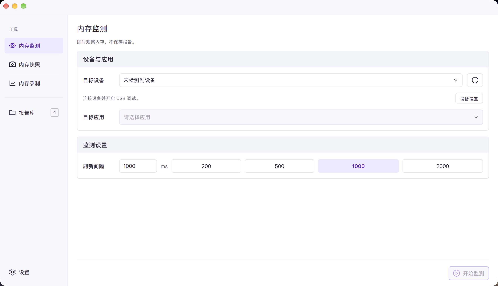
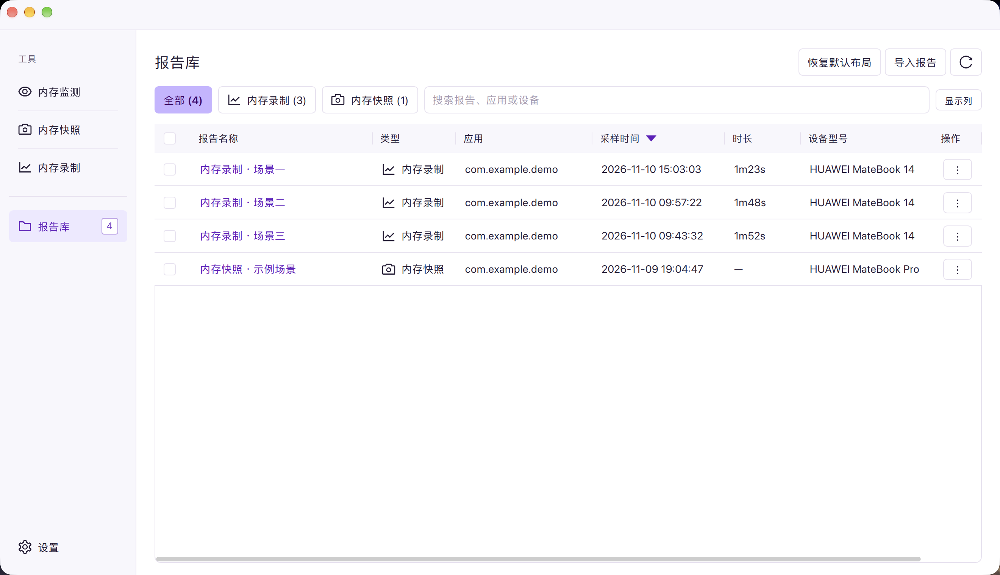
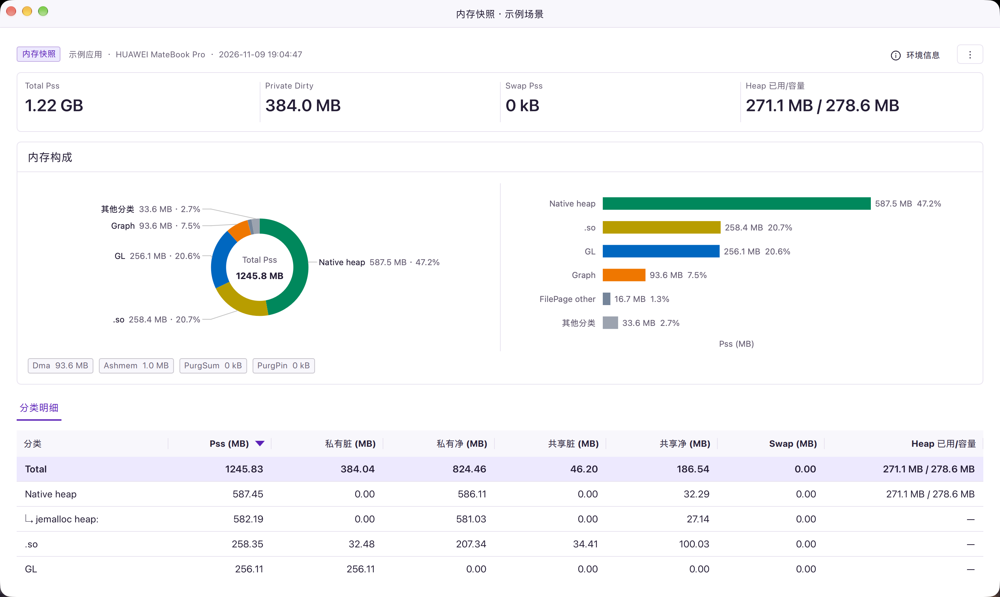
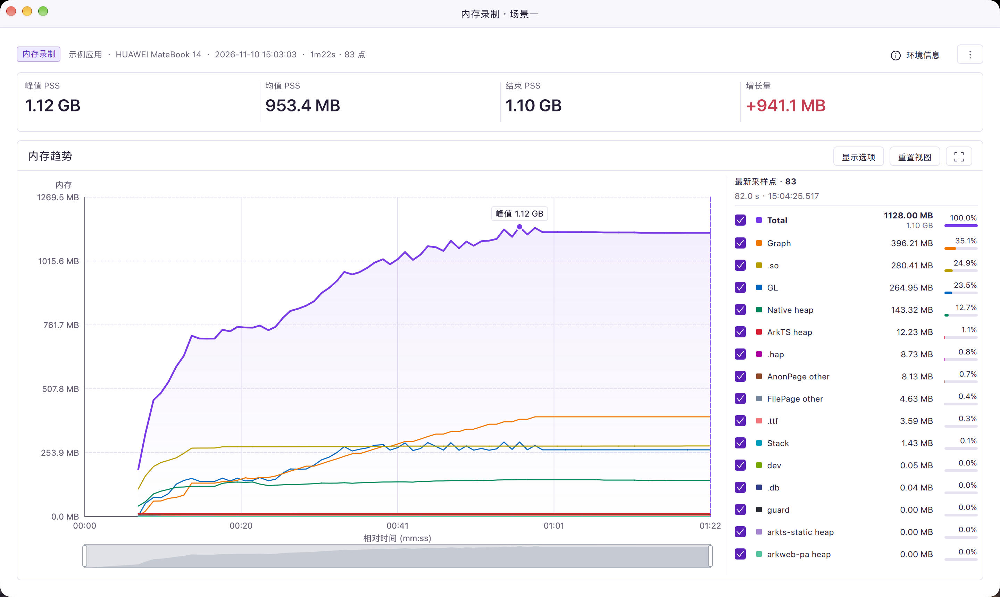
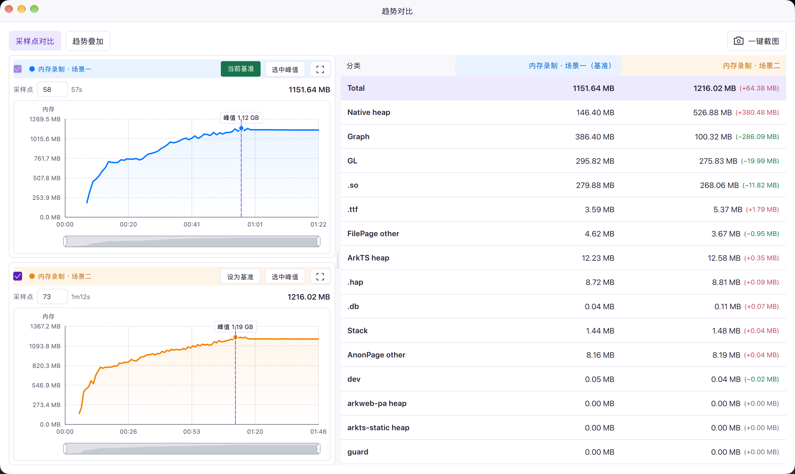

<p align="center">
  
</p>

# Woody

[](https://github.com/jerome-tan/woody-harmony/actions/workflows/qt.yml)
[](https://github.com/jerome-tan/woody-harmony/releases/latest)
[](LICENSE)

HarmonyOS开发者工具，支持 macOS / Windows。通过 hdc 执行 `hidumper`，提供内存监测、内存快照、内存录制和多报告对比。

项目仅维护 **Qt 6.12.0 原生版**，使用 C++20 / Qt Quick。源码构建和打包无需 Node.js、npm 或浏览器运行时。

迁移时的包体积、性能对照和验证边界作为历史记录保存在 [Qt 验证报告](qt/VALIDATION.md)；当前界面和交互检查见 [设计验收记录](design-qa.md)。

## 下载

开发构建在 [Native Qt Actions](https://github.com/jerome-tan/woody-harmony/actions/workflows/qt.yml) 的 Artifacts 下载，正式发布在 [Releases](https://github.com/jerome-tan/woody-harmony/releases)。请选择文件名包含 `-qt-` 的产物；旧版本发布保留为历史记录。

`woody-qt-package-<平台>-<架构>` 包含安装包和免安装 ZIP；`woody-qt-evidence-*` 包含截图、测试结果、体积明细和性能原始数据。

| 平台 | 安装包 | 免安装包 |
| --- | --- | --- |
| macOS Apple Silicon（M 系列） | `Woody-<版本>-qt-mac-arm64.dmg` | `Woody-<版本>-qt-mac-arm64-portable.zip` |
| macOS Intel | `Woody-<版本>-qt-mac-x64.dmg` | `Woody-<版本>-qt-mac-x64-portable.zip` |
| Windows x64 | `Woody-<版本>-qt-win-x64-setup.exe` | `Woody-<版本>-qt-win-x64-portable.zip` |

Windows 免安装版是完整程序目录的 ZIP：将 ZIP 全部解压到独立文件夹，再双击其中的 `Woody.exe`，无需安装或管理员权限，也无需每次启动时临时解压。请保留同目录的 `qml/`、插件、DLL 等文件，不能只复制 `Woody.exe`。macOS 免安装版解压 ZIP 后直接打开 `Woody.app`，也可自行移动到常用目录。

从 Actions 下载时，Artifact 的外层 ZIP 内还包含上述免安装 ZIP，需要继续解压；从 Release 下载则直接获得程序 ZIP。

免安装版与安装版使用相同的设置和报告保存位置，报告默认仍在用户主目录的 `.woody/reports/`，可在「设置」中更改。程序所在目录不会自动成为数据目录；hdc 仍需按下文配置。

macOS 打开 DMG 后，将左侧 Woody 拖到右侧 Applications 文件夹，复制完成后推出磁盘，再从“应用程序”启动。重新打包后测试安装界面时，请先推出旧镜像，再打开新 DMG，以免看到旧的挂载内容。

每个正式版本附带 `SHA256SUMS.txt`，覆盖该版本发布的所有安装包和免安装包。macOS 应用使用 ad-hoc 签名，未配置 Apple Developer ID 签名与公证；Windows 程序未配置代码签名，首次运行可能出现系统安全提示。

## 应用内更新

在 **Help → 检查更新…** 或 **设置 → 软件更新** 中检查 GitHub Release。默认每次启动检查一次；可关闭“启动时检查更新”。仅检查正式 Release，按版本号比较，忽略草稿、预发布、相同或更低版本。

发布流水线会附带 `update.json` 更新清单。客户端优先读取这个公开附件，避免消耗 GitHub 未登录 API 的请求配额；旧 Release 没有清单时兼容查询 API。

发现新版后，点击“下载更新”，程序自动选择当前平台、程序架构及安装形式的附件，显示下载进度，并用同一 Release 的 `SHA256SUMS.txt` 验证大小与 SHA-256。确认“安装并重启”后才退出应用；采集尚未结束时不可安装。

- **Windows 安装版**：运行新版安装程序，更新到原安装目录并重新打开。
- **Windows ZIP 版**：退出后替换程序目录，保留文件清单之外的用户文件；新版成功打开后清理旧程序，新版启动失败时尝试回退。
- **macOS**：下载对应 Apple Silicon / Intel 的 ZIP，替换当前 `Woody.app` 并重新打开；新版启动失败时尝试回退。请先将应用从 DMG 拖入“应用程序”或其他可写目录。

更新保留已保存的设置和报告；安装会关闭全部报告窗口。只读目录、系统权限或安全策略不允许自动安装时，可以从更新窗口打开 Release 页面手动安装。网络不可用时可继续使用当前版本，稍后重新检查。

发布更新必须递增根目录 `VERSION` 并推送对应标签（例如 `v1.0.1`）。替换同名 `v1.0.0` 的 Release 附件不会触发更新。旧版没有更新功能，需先手动安装一次包含该功能的版本。当前机制通过 HTTPS 和 Release 校验文件验证下载完整性，沿用现有软件包签名状态，不等同于新增开发者签名或公证。

## 功能

- **设备与应用**：自动探测 hdc，通过 Windows/macOS 系统事件监听 USB 设备插入与断开（不做周期轮询），查看型号、系统/API 版本、内存、分辨率与应用运行状态。断开时清空当前应用及 PID，同一设备重连后恢复上次选择（应用仍安装时）。
  - 应用列表仅在连接或切换目标设备、打开“选择应用”窗口、手动刷新应用列表时获取，不做周期轮询。
  - 打开应用列表时自动定位当前已选应用。目标选择页面可见且程序处于前台时，仅对已选应用每 3 秒更新运行状态；切换应用或返回前台时立即检查，不重新加载完整应用列表。
  - 启动、系统唤醒和插拔事件后检查 HDC；确认设备通信通道可执行命令后才读取设备和应用信息，事件后的就绪重试最多持续约 10 秒，成功后提前停止。没有低频兜底检查。若稍后才完成调试授权、重启 HDC 服务或改变网络设备连接，可点击“刷新设备”，重新读取已选设备的信息和应用列表。
- **内存监测**：查看 Total PSS 和 GL、Graph、ArkTS heap、native heap 等分类趋势，支持缩放、平移、自动跟随；不落盘、不生成报告。
- **内存录制**：配置采样间隔与时长，默认每秒采样、10 分钟自动结束；保存结构化样本和 hidumper 原文。
- **内存快照**：定格当前进程内存构成，可附加 ashmem、DMA、GPU 明细，以及单独采集 smaps 原文。
- **报告管理**：加载历史、搜索筛选、重命名、删除、打开目录，并在独立窗口查看报告。
- **报告对比**：选择 2～4 份同类型报告，按开始、峰值或结束对齐趋势，也可比较选定采样点和快照分类差异。

## 软件界面

以下为 macOS 上 Qt 版本的实际界面，应用包名和报告名称已替换为通用示例名称，点击图片可查看原图。

### 主页

内存监测、内存快照和内存录制使用独立入口；主页用于选择设备、目标应用及采集参数。图中为尚未连接设备的状态。

[](docs/images/home.png)

### 报告库

集中管理内存快照和内存录制报告，支持搜索、类型筛选、排序、导入和多报告对比。

[](docs/images/report-library.png)

### 查看单个内存快照

通过环形图、条形图和分类明细查看内存构成；宽窗口下两个图表并排显示。

[](docs/images/memory-snapshot.png)

### 查看单个内存录制

查看峰值、均值、结束内存与增长量，并通过趋势图选择采样点，查看对应的分类数据。

[](docs/images/memory-recording.png)

### 对比两个内存录制

左侧选择各报告的采样点及基准，右侧查看分类差值：红色表示内存增加，绿色表示内存减少；也可切换到趋势叠加模式。

[](docs/images/recording-comparison.png)

## 使用要求

- Windows 10 1809+ / Windows 11（x64），或 macOS 14.4+（Apple Silicon / Intel）。这是所选 Qt 6.12 SDK 的系统基线。

- 本机有可用的 hdc（DevEco Studio 或 HarmonyOS / OpenHarmony SDK 自带）。Woody 会在常见 SDK 目录、`HDC_PATH` 和 PATH 中查找，也可在「设置」中手动指定路径。
- 鸿蒙设备已开启开发者模式 / USB 调试，并完成连接授权。
- smaps 和部分资源明细是否可用，取决于系统版本、应用构建类型及设备权限。

## 使用流程

1. 启动后确认顶部设备信息；必要时在「设置」中配置 hdc 路径。
2. 在左侧独立入口选择「内存监测」「内存快照」或「内存录制」。
3. 选择目标设备和应用，配置参数并开始采集。
4. 内存录制结束或快照完成后，查看生成的报告；在「报告库」中选择同类型报告进行对比。

内存监测和内存录制允许在应用尚未启动时开始：此时进入等待状态，待手动启动应用后自动采集；等待记录不计入有效统计或显示成零内存。Woody 不会自动启动应用。内存快照要求目标应用正在运行。同一设备的目标应用选择会在三个入口间共享并保存，未运行仍保留选择，卸载后清空。

报告查看与对比窗口分别记忆关闭时的最大化状态：上次最大化则下次仍最大化；普通状态下关闭，则下次按默认大小居中打开。

主窗口、报告窗口和对比窗口使用统一的单行顶栏。macOS 保留左上角系统按钮和屏幕顶部菜单；Windows 在顶栏左侧显示 logo、应用名和 Help 菜单（`Alt+H`），右侧保留系统最小化、最大化、关闭按钮。Help 提供「关于 Woody」。Windows 支持 `Ctrl+W` 关闭当前窗口、`Ctrl+M` 最小化、`Ctrl+Q` 退出应用。

## 数据保存

默认保存到用户主目录下的 `.woody/reports/`，可在「设置」中修改输出目录。

| 类型 | 内容 |
| --- | --- |
| 内存录制 | `meta.json`、`samples.jsonl`、`raw/` 下每次采集的原始文本 |
| 内存快照 | `meta.json`、`snapshot.json`、hidumper 原始文本；勾选 smaps 后另存 `.smaps.txt` |
| 内存监测 | 仅保留在内存中，不生成文件 |

## 开发

使用根目录的 `build.py` 一键完成 **依赖检查 → 准备 Qt SDK → Release 编译 → CTest 测试 → 打包**。任一步失败立即停止；测试失败不会进入打包。无需 Node.js / npm，也不需要连接真实设备。

### 首次准备

| 平台 | 需要安装的系统依赖 |
| --- | --- |
| macOS 14.4+（Apple Silicon / Intel） | Python 3.10+、Git、Xcode Command Line Tools、CMake 3.24+、Ninja |
| Windows x64 | Python 3.9+、Git、CMake 3.24+、Visual Studio 2022 或 Build Tools 2022（选择“使用 C++ 的桌面开发”，含 MSVC v143 和 Windows 10/11 SDK）、7-Zip、NSIS 3 |

Python、Git 和 CMake 需加入 PATH；macOS 的 Ninja 也需加入 PATH。Windows 会自动查找常规安装目录中的 Visual Studio、7-Zip 和 NSIS，无需在 Developer Command Prompt 中运行。macOS 可用 `xcode-select --install` 安装命令行工具，已安装 Homebrew 时可用 `brew install cmake ninja` 安装构建工具。

脚本会检查上述依赖并报告缺失项，**不会自动安装系统级工具或申请管理员权限**。Qt **6.12.0** SDK 缺失时会自动下载官方归档、校验并安装到 `dist/qt-sdk`；后续构建复用 SDK 和编译缓存。macOS 首次生成 DMG 时，还会在 `dist/dmg-tools` 隔离环境中自动安装锁定版本和 SHA-256 的 `dmgbuild` 及依赖，不修改全局 Python 环境。首次下载需要联网；依赖和 SDK 齐全后可离线构建。

### 一键构建

在项目根目录运行：

```bash
# macOS：自动选择本机 arm64 / x64
python3 build.py
```

```powershell
# Windows x64：PowerShell 或命令提示符均可
py -3 build.py
```

Windows 未安装 Python Launcher 时可改用 `python build.py`。路径含空格或中文也可使用。脚本始终以自身所在的仓库根目录构建，不受当前终端目录影响，例如 `python3 /path/to/woody-harmony/build.py`。

常用选项（Windows 将 `python3` 替换为 `py -3`）：

```bash
# 仅检查环境：不下载、不编译、不打包
python3 build.py --check

# 调整并行编译数（默认最多 4）
python3 build.py --jobs 8

# 使用已安装的完整 Qt 6.12.0 kit；不会下载 Qt
python3 build.py --qt "/path/to/Qt/6.12.0/macos"
# Windows 对应：py -3 build.py --qt "C:\Qt\6.12.0\msvc2022_64"

# 仍执行编译和测试，仅生成程序目录及 ZIP，不生成 DMG/安装 EXE
# Windows 使用此选项时无需 NSIS
python3 build.py --skip-installer

# 本地快速构建：跳过测试程序的编译和执行，仍正常打包
python3 build.py --skip-tests
# Windows 对应：py -3 build.py --skip-tests

# 可同时跳过测试和安装包制作，仅生成程序目录及 ZIP
python3 build.py --skip-tests --skip-installer
```

`--check` 在 Qt 尚未安装时会检查下载所需工具，并提示正式构建时将安装 SDK；它不验证网络连通性。`--qt` 必须指向 kit 目录，而不是 Qt 安装根目录，且需包含本项目使用的模块，详见 [Qt 构建说明](qt/README.md)。脚本只构建当前平台和架构，不交叉编译。

### 构建结果

| 内容 | 固定输出位置 |
| --- | --- |
| 编译缓存、测试程序和测试日志 | `dist/qt-build.noindex`；测试日志在 `Testing/Temporary/LastTest.log` |
| macOS 应用 | `dist/qt-package/staging/Woody.app` |
| Windows 程序目录 | `dist/qt-package/staging/Woody/`（运行其中的 `Woody.exe`） |
| 安装包、免安装 ZIP、体积与校验信息 | `dist/qt-package/` |

macOS 默认生成 DMG + ZIP：DMG 使用淡紫色安装背景，左侧 Woody、右侧 Applications，配有拖拽箭头及中文安装说明；支持 Retina 显示，窗口默认大小为 640 × 432 点。生成布局无需授权控制 Finder。Windows 默认生成安装 EXE + ZIP；文件名包含根目录 `VERSION` 中的版本号。本地迭代固定复用上述目录，同版本、同架构的产物原位更新，不会为每次修改创建新的程序包目录；更新前请退出正在运行的打包版 Woody。脚本不会启动应用、推送 GitHub 或发布 Release。

修改代码后再次运行同一条命令即可增量编译，并重新测试和打包。默认执行测试；`--skip-tests` 仅对本次命令生效，下次不带此参数会重新启用测试，不影响 GitHub Actions。若切换 Qt kit、架构、生成器或移动仓库后提示构建缓存不一致，请移除 `dist/qt-build.noindex` 后重试；用户设置和报告不在这个目录中。失败时旧安装包可能仍保留，请以脚本最后的完成提示为准；跳过测试时会明确标注“已跳过测试”。

原生代码位于 `qt/src/`，界面位于 `qt/qml/`，测试位于 `qt/tests/`，应用图标位于 `qt/resources/`。手动 CMake 构建、交互回归和性能测试步骤见 [Qt 构建说明](qt/README.md)。

## GitHub Actions 与版本发布

[Native Qt build and validation](.github/workflows/qt.yml) 自动构建 Windows x64、macOS arm64 和 macOS Intel：

- 推送 `main`、`codex/qt-*`，或提交面向 `main` 的 PR：编译、后端测试、原生界面回归、打包、部署后回归，以及三轮 Qt 启动、内存和交互 CPU 测量。
- Windows 额外验证中文路径下 ZIP 解压启动、安装版启动和卸载保留用户文件。
- 推送 `v*` 标签：必须与 `VERSION` 一致；三平台全部成功后，发布六个 Qt 包和 `SHA256SUMS.txt`。
- 普通分支推送只产生 Actions Artifacts，不发布 Release。Artifacts 保留 14 天。

发布任务使用 GitHub 自动提供的 `GITHUB_TOKEN`，无需额外配置个人访问令牌。普通构建只有仓库读取权限，发布任务单独申请 `contents: write`。

后续发布示例（工作区需干净）：

1. 如需自定义说明，先提交 `.github/release-notes/v1.0.1.md`；没有对应文件时自动生成说明。
2. 更新版本并推送：

   ```bash
   printf '1.0.1\n' > VERSION
   git add VERSION
   git commit -m "Release v1.0.1"
   git tag v1.0.1
   git push origin main
   git push origin v1.0.1
   ```

如果构建或上传失败，修复后可重跑工作流；未完成的 Release 保持草稿状态。已正式发布的版本不会被工作流覆盖，应使用新版本号发布后续改动。

## 许可证

[MIT](LICENSE)。Qt 动态库及其第三方组件的许可说明随包附带，见 [qt/licenses](qt/licenses)。
